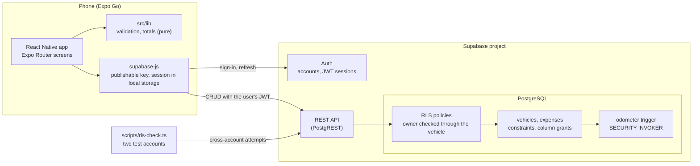

# AutoLedger

[](https://github.com/SamLittleJ/AutoLedger/actions/workflows/ci.yml)

AutoLedger is a mobile app for recording a car's expenses (service, repairs, fuel,
consumables, accessories), reviewing the history, and seeing monthly and total
spending in RON. It is a learning project built for a university course and for
a portfolio. The domain is well known and similar apps exist (for example Drivvo,
Fuelio and Simply Auto), so the emphasis is on execution: tested data isolation,
a clean schema, and documentation. The user interface is in Romanian.

## Features

- Email and password accounts with a persistent session.
- One vehicle per account, with its current odometer.
- Expenses in six categories, with date, description, cost, optional odometer
  and notes: add, edit, delete with confirmation.
- An expense with a higher odometer reading raises the vehicle's odometer; a
  lower or missing reading leaves it unchanged.
- Summary: spent this calendar month, total spent, latest five expenses.
- History ordered by date, filterable by category.
- Clear messages for validation, network and server errors; forms keep their
  values for a retry.

## Status

All five weeks of the plan are implemented. Weeks 1–4 are verified on a phone
and by the automated checks; week 5 (portfolio and demo) is being finalized.
The full plan, including design decisions and scope, is in
[docs/PLAN.md](docs/PLAN.md) (in Romanian).

## Architecture



Totals are computed on the phone from the loaded expenses, in pure functions
with unit tests. The database enforces types, constraints and ownership; the app
never holds a secret key.

## What I built and what the services provide

Supabase and Expo provide the infrastructure:

- **Supabase:** account storage and password hashing, JWT sessions and their
  refresh, the REST API generated from the schema, PostgreSQL hosting, and the
  RLS engine that applies the policies.
- **Expo:** the React Native toolchain, Expo Go, file-based routing.

The project's own work is the data model and its guarantees, plus the app:

- **Schema** (`supabase/migrations/`): two tables with `numeric(10,2)` costs,
  `date` expense days, ASCII category codes, `CHECK` constraints, and
  column-level grants (for example, an expense cannot be moved to another
  vehicle through an update).
- **RLS policies:** an expense's owner is checked through its vehicle with
  `EXISTS` in both `USING` and `WITH CHECK`. There is deliberately no `user_id`
  on `expenses`, so ownership has a single source of truth.
- **Odometer trigger:** raises the vehicle's odometer only for a higher reading,
  runs as the calling user so RLS still applies, and never lowers it.
- **Verification:** `scripts/rls-check.ts` attacks one account's data from
  another through the REST API and tests the trigger; unit tests cover totals
  (including month boundaries and the change of year), parsing of Romanian
  decimal input, validation and error mapping; a manual phone checklist covers
  sessions and offline behavior. CI runs lint, type checks and unit tests.
- **App:** screens, forms, loading, error and empty states, and the client-side
  calculations.

## Security model

- Row Level Security is enabled on every table.
- Policies compare against `(select auth.uid())`, as recommended by Supabase for
  query performance.
- The app uses only the Supabase URL and the publishable key, read from
  `EXPO_PUBLIC_*` environment variables. No secret keys, database passwords or
  `.env` files are committed.
- Expense ownership is checked through the associated vehicle with an `EXISTS`
  condition in both `USING` and `WITH CHECK`; `expenses` has no `user_id`
  column.
- A cross-account script (`scripts/rls-check.ts`) verifies the isolation
  through the REST API, using only the publishable key (see below).

## Tech stack

- React Native with Expo SDK 58 and TypeScript
- Expo Router for navigation
- Supabase: Auth, PostgreSQL with Row Level Security, auto-generated REST API
- Supabase CLI for versioned SQL migrations
- Jest with jest-expo for unit tests

## Getting started

Prerequisites:

- Node.js 22
- Expo Go installed on a phone
- A Supabase project

```bash
npm install
```

Copy the environment template and fill in the values from your Supabase project
(Project Settings, API):

```bash
cp .env.example .env
# set EXPO_PUBLIC_SUPABASE_URL and EXPO_PUBLIC_SUPABASE_PUBLISHABLE_KEY
```

Use the base project URL (`https://<ref>.supabase.co`), not the Data API endpoint
ending in `/rest/v1/`; otherwise every auth request returns 404.

Apply the database migrations:

```bash
npx supabase login
npx supabase link --project-ref <ref>
npx supabase db push
```

Disable "Confirm email" in the Supabase Auth settings. Supabase's built-in email
service delivers only to the email addresses of the project's team members, so
with confirmation on, nobody else could create an account. A real deployment
would configure a custom SMTP server and turn confirmation on.

Start the development server and scan the QR code with Expo Go:

```bash
npx expo start
```

## Demo

### Before the demo

1. Free-tier Supabase projects pause after a period of inactivity. Open the
   project in the Supabase dashboard and resume it if needed.
2. Reset the demo account to its known data:

   ```bash
   cp .env.demo.example .env.demo   # URL, publishable key, demo account
   cp demo-data.example.json demo-data.json   # then fill in real expenses
   npm run seed-demo
   ```

   The script signs in as the demo account, sets its vehicle, deletes all its
   expenses and inserts the ones from `demo-data.json`. A row the database
   rejects is named in the output. `.env.demo` and `demo-data.json` are not
   committed.

### Scenario

1. Sign in with the demo account. The summary shows the vehicle, spending this
   month and the total.
2. Add a fuel expense dated today with an odometer above the vehicle's. Both
   totals and the vehicle odometer go up.
3. In "Istoric", filter by "Combustibil".
4. Open an expense, change its cost, save; then delete it and confirm.
5. Run `npm run rls-check` to show that a second account cannot read or change
   the first account's data.

## Checks

```bash
npx expo lint
npx tsc --noEmit
npm test
```

### RLS check

`scripts/rls-check.ts` signs in as two dedicated test accounts, A and B, and
tries to read, insert, update and delete A's vehicle and expenses as B,
including inserting an expense on A's vehicle and moving one of B's expenses
onto it. Every attempt must fail or affect zero rows; an anonymous client must
see nothing. It also checks that the odometer trigger raises
`current_odometer` only for a higher reading, both when an expense is added and
when it is edited, and never lowers it. Test rows are removed at the end.

```bash
cp .env.test.example .env.test
# fill in the Supabase URL, publishable key and the two test accounts
npm run rls-check
```

Create both accounts in the app first. Do not use a real account: the script
writes data. Run it again after any change to policies or the trigger.

The lint, type and unit checks run in GitHub Actions on every push and pull request
(see [.github/workflows/ci.yml](.github/workflows/ci.yml)).

Expo Router's typed routes are generated in `.expo/types/` only while
`npx expo start` runs. After adding a screen, start the dev server once before
`npx tsc --noEmit`, or the new route fails to type-check locally. CI has no
`.expo/` folder, so it does not check route names.

### Manual tests

Phone checks (account, session, no connection, expense flow) are listed in
[docs/manual-tests.md](docs/manual-tests.md), with a log of past runs.

## Project structure

```
src/
  app/          Expo Router screens and layouts ((auth) and (app) groups)
  components/   Shared UI components
  lib/          Supabase client, data access, validation, pure helpers
  types/        Generated database types
scripts/
  rls-check.ts  Cross-account RLS and trigger check
  seed-demo.ts  Resets the demo account's data
supabase/
  migrations/  Versioned SQL migrations (schema, RLS policies)
docs/
  PLAN.md       Implementation plan and design decisions (Romanian)
  manual-tests.md  Phone test checklist and run log
```

## Known limitations

- Supabase free-tier projects pause after a period of inactivity. Resume the
  project in the Supabase dashboard before a demonstration.
- Email confirmation is off: the built-in email service only reaches the
  project's team members (see Getting started). Turning it on needs a custom
  SMTP server; the confirmation link would also open in a browser, not the app
  (no deep link).
- The app works online only; there is no offline mode.
- One vehicle per account.
- Light appearance only; the app does not follow the phone's dark mode.
- Dates are typed as `AAAA-LL-ZZ` (today is prefilled); there is no date picker.
- Sign-out works offline in the usual case, but after more than an hour without
  a connection the access token has expired and signing out needs the network
  (supabase-js refreshes the session first). The app shows a connection message.
- Delete confirmations use `Alert.alert`, which shows no dialog on web. The
  app targets Android and iOS through Expo Go.

## License

MIT. See [LICENSE](LICENSE).
